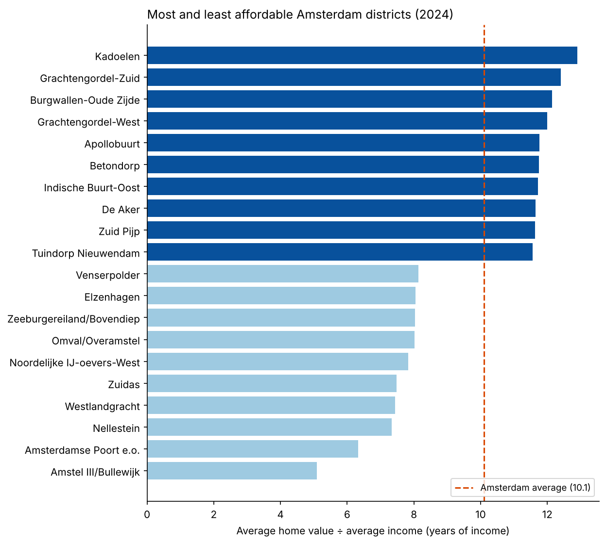
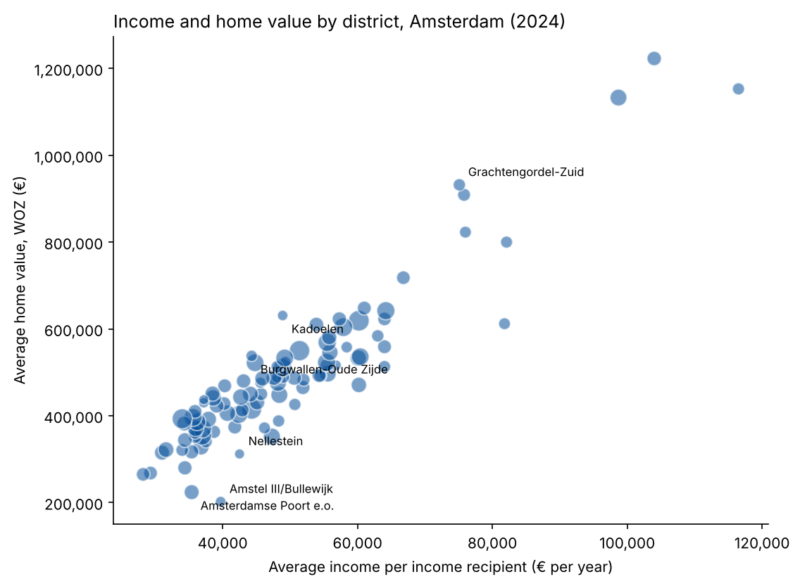
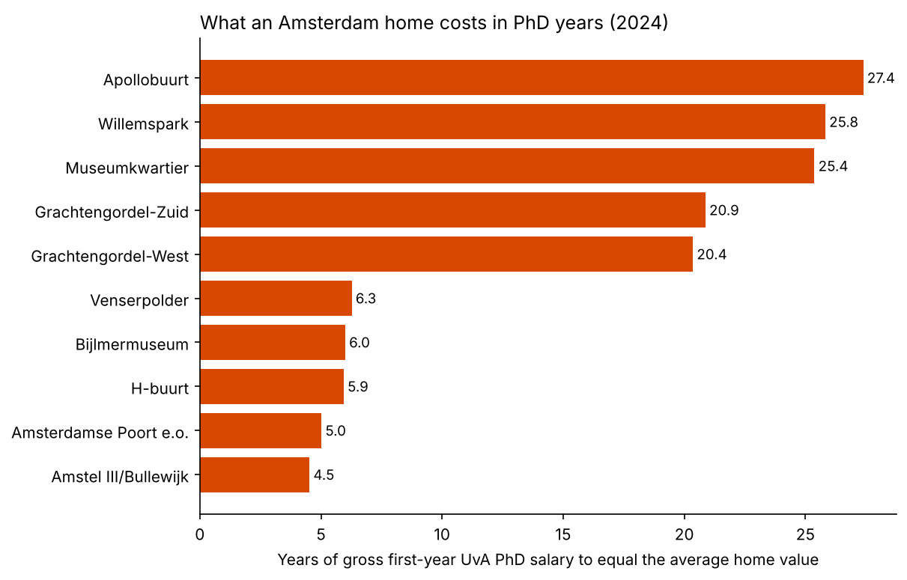

# Can I afford to live here? Housing affordability in Amsterdam

Like many people who move to Amsterdam, my first real question about the city was a housing question. This project answers it with open government data: **which Amsterdam districts are most and least affordable, and how many years of a PhD salary does an average home cost?**

## Data

| Source | What it gives | Licence |
|---|---|---|
| [CBS – Kerncijfers wijken en buurten](https://www.cbs.nl/nl-nl/cijfers/detail/85984NED) (Statistics Netherlands) | Average home value (WOZ), average income per income recipient, residents, per district | CC BY 4.0 |
| [PDOK – CBS Wijken en Buurten](https://data.overheid.nl/dataset/71520-wijk--en-buurtkaart-2024-versie-1) | District boundaries for the map | CC BY 4.0 |

Data is downloaded automatically with the [`cbsodata`](https://pypi.org/project/cbsodata/) package and cached in `data/raw/`.

## Method

1. Find all yearly *Kerncijfers wijken en buurten* tables in the CBS catalogue.
2. Use the newest year in which at least 80% of Amsterdam districts have both a home value and an income figure (income data is published later than housing data).
3. Keep Amsterdam districts (*wijken*) and translate the Dutch columns.
4. Calculate per district:
   - **Price-to-income ratio** = average home value ÷ average income per income recipient. Higher means less affordable.
   - **Years of PhD salary** = average home value ÷ first-year UvA PhD gross salary (EUR 3,200/month plus 8% holiday and 8.3% year-end allowance ≈ EUR 44,660/year).
5. Compare each district with the Amsterdam average, and visualise.

## How to run

```bash
pip install -r requirements.txt
python run.py            # full analysis; results in outputs/ and figures/
python -m pytest         # tests
jupyter notebook affordability.ipynb   # step-by-step version
```

Options: `python run.py --year 2023` (force a year), `--refresh` (re-download), `--no-map`.

## Results

Run on the **CBS 2024 table** (85984NED): 96 of Amsterdam's 110 districts have both a home value and an income figure. The 2025 and 2026 tables do not yet contain income data. Full table: [`outputs/amsterdam_district_affordability.csv`](outputs/amsterdam_district_affordability.csv) · summary: [`outputs/summary.md`](outputs/summary.md).

| | Amsterdam as a whole |
|---|---|
| Average home value (WOZ) | EUR 498,000 |
| Average income per income recipient | EUR 49,300 |
| Price-to-income ratio | **10.1** |
| Average home in first-year PhD salaries | **11.2 years** |
| Correlation between district income and home value | 0.93 |







`python run.py` also draws an affordability map (`figures/affordability_map.png`) from PDOK district boundaries.

**Key findings**
1. **An average Amsterdam home costs about 10 years of a typical local income**, and about 11 years of a first-year PhD salary. 44 of 96 districts are above the city average.
2. **The most affordable districts relative to income are in Zuidoost** (Amstel III/Bullewijk 5.1, Amsterdamse Poort 6.3, Nellestein 7.3). The least affordable are Kadoelen in Noord (12.9) and the historic centre: Grachtengordel-Zuid (12.4), Burgwallen-Oude Zijde (12.1) and Grachtengordel-West (12.0).
3. **Expensive is not the same as unaffordable for residents.** Income and home value move closely together (r = 0.93): Willemspark homes average EUR 1.15 million, yet the ratio (9.9) is below the city average because local incomes are also very high. For a newcomer on a PhD salary the picture is different: only 16 districts have an average home value below 8 years of gross salary, and in Apollobuurt it is 27 years.

## Limitations

- **WOZ value is a tax valuation**, not the market price; actual prices in Amsterdam are usually higher.
- **Most residents rent.** A price-to-income ratio describes buying, not renting; rent data per district is not in this table.
- **Averages hide inequality** within districts, and income is per income recipient, not per household.
- **Years differ in completeness**: CBS publishes income later than housing, and some small districts are left blank for privacy.

## Next step

Add air-quality measurements (EEA) to ask whether affordable districts also breathe worse air.

## Project structure

```
├── run.py                    # one-command pipeline
├── affordability.ipynb       # step-by-step notebook
├── src/amsterdam_housing/
│   ├── data.py               # download + clean CBS data
│   ├── analysis.py           # affordability metrics + summary
│   ├── plots.py              # charts and map
│   └── geo.py                # district boundaries from PDOK
├── tests/test_pipeline.py    # tests on a small CBS-shaped sample
├── data/raw/                 # cached downloads (not committed)
├── outputs/                  # CSV + summary.md
└── figures/                  # PNG charts
```
